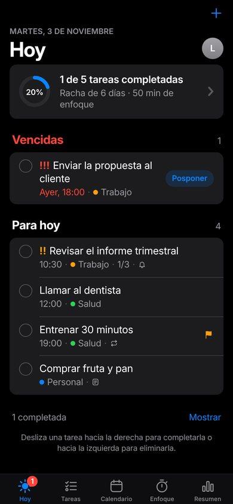
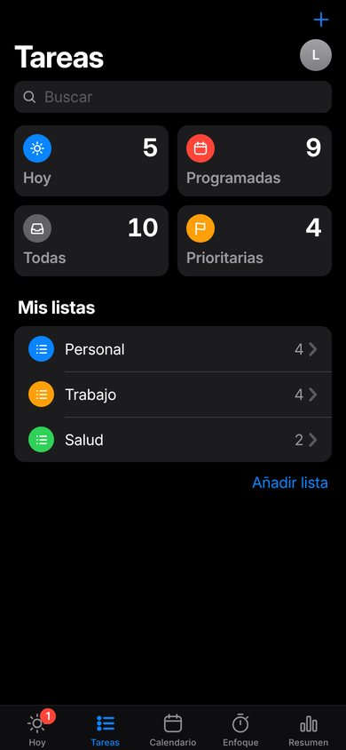
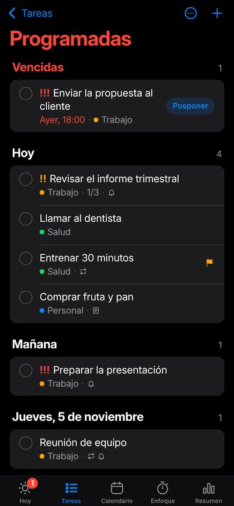
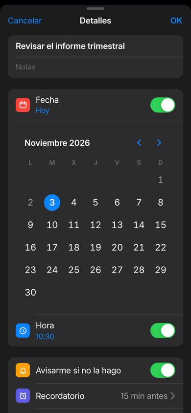
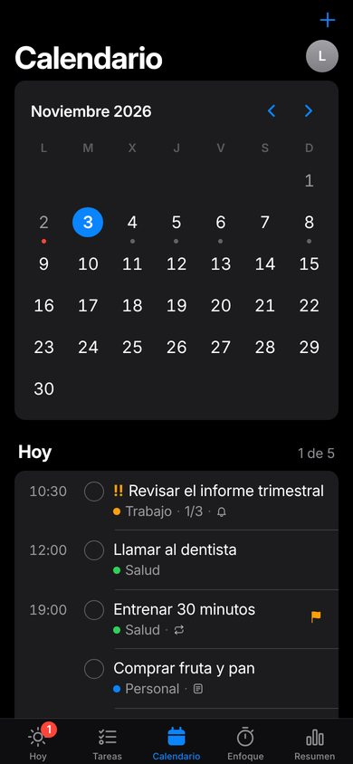
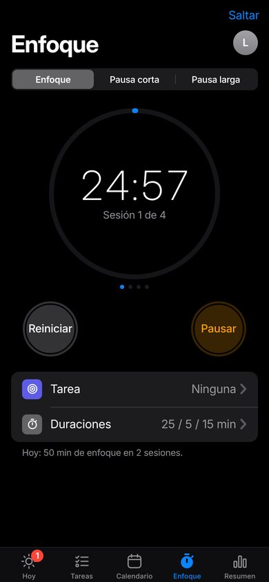
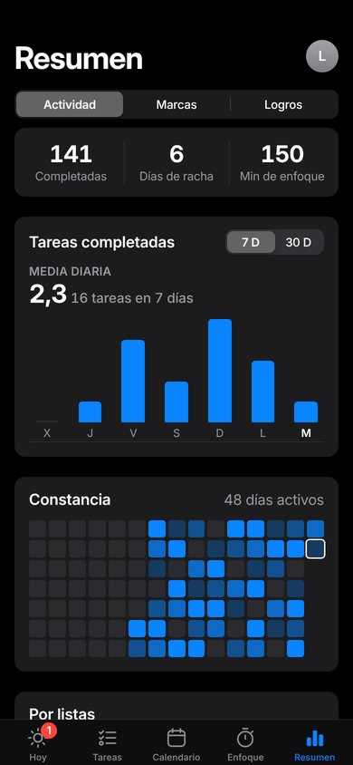
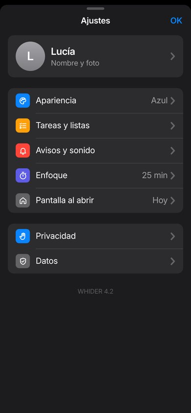

# WHIDER 4.2

**Tu día, bajo control.** WHIDER es una app de productividad para Android (y cualquier navegador) que reúne tareas y listas, calendario, avisos por incumplimiento, modo enfoque y seguimiento de progreso. Desde la 4.2 tiene un **diseño sobrio inspirado en las apps de Apple**: fondo negro, celdas agrupadas, un único color de acento, tipografía limpia y nada de efectos llamativos. Incluye **cuentas de usuario** (correo y contraseña o Google) con **copia en la nube** y un **registro de marcas** que conserva tus récords para siempre. Funciona también sin conexión.

<p align="center">
  
  
  
  
</p>
<p align="center">
  
  
  
  
</p>

---

## 🧭 Organización

Cinco pestañas fijas abajo, siempre en el mismo sitio:

| Pestaña | Qué encontrarás |
| --- | --- |
| **Hoy** | Progreso del día, lo **vencido** (con *Posponer*) y lo que toca hoy. La pestaña muestra cuántas tareas están vencidas. |
| **Tareas** | Buscador, **listas inteligentes** (Hoy · Programadas · Todas · Prioritarias) y **Mis listas** (Personal, Trabajo…). Cada lista abre su propia página. |
| **Calendario** | Mes en cuadrícula (desliza para cambiar de mes) y las tareas del día elegido, ordenadas por hora. |
| **Enfoque** | Temporizador de sesiones y pausas, con la tarea en la que te concentras. |
| **Resumen** | Actividad (gráfica, constancia, listas y nivel), **Marcas** y **Logros**. |

Tu **foto de perfil** (arriba a la derecha) abre **Ajustes**: cuenta y copia en la nube, apariencia, tareas y listas, avisos y sonido, enfoque, pantalla al abrir, privacidad y datos. Cada apartado es una página, como en los ajustes del teléfono. El botón **+** de la barra superior crea una tarea en cualquier pantalla.

---

## ✨ Funciones

**Cuentas y copia en la nube**
- Registro con **correo y contraseña** (con verificación del correo, medidor de seguridad de la contraseña y recuperación por correo) o con **Google** (en Android, con el selector nativo de cuentas del teléfono).
- Opción para admitir **solo correos de empresa** (`allowedEmailDomains`).
- Tus tareas, listas, marcas, enfoque y ajustes se guardan en tu cuenta y se **sincronizan automáticamente** entre dispositivos (al abrir la app, al volver a ella, cada minuto y tras cada cambio); los cambios de varios móviles se fusionan sin perder nada.
- Funciona sin internet y sincroniza al volver la conexión. Cerrar sesión y **eliminar la cuenta** desde Ajustes → Cuenta.
- Modo **sin cuenta** opcional: los datos se quedan en el dispositivo y se suben a la cuenta si la creas más tarde.
- Configuración: [docs/CONFIGURAR-CUENTAS.md](docs/CONFIGURAR-CUENTAS.md).

**Tareas y listas**
- Prioridades al estilo de Recordatorios: **!!! urgente**, **!! importante** y **bandera** para las destacadas.
- **Listas** con su color, más cuatro **listas inteligentes** que se rellenan solas.
- Fecha con **calendario integrado**, hora, **subtareas**, **notas** y **repeticiones** (cada día, días laborables, cada semana, cada mes).
- **Gestos**: desliza → para completar y ← para eliminar, con **Deshacer**.
- Búsqueda en títulos, notas y subtareas; orden por fecha, prioridad, recientes o título.
- Si cierras el editor con cambios sin guardar, WHIDER te pregunta antes de descartarlos.

**Avisos**
- **Recordatorio previo** configurable (de 5 minutos a 1 día antes) y **aviso si no la haces** al vencer el plazo, repetible cada 10, 20 o 60 minutos.
- **Horas de silencio**: sin sonidos ni notificaciones en tu horario de descanso.
- En la app Android, los recordatorios **suenan aunque la app esté cerrada** y se restauran al reiniciar el móvil.

**Calendario**
- Mes completo con un punto en los días con tareas (rojo si hay algo vencido) y lista del día con su hora.

**Enfoque**
- Sesiones y pausas cortas o largas, con pausas automáticas opcionales y una tarea vinculada.
- Exacto aunque la app pase a segundo plano. Notificación y sonido suave al terminar.

**Resumen, marcas y logros**
- Completadas, racha y minutos de enfoque; gráfica de 7 o 30 días, **mapa de constancia** de 15 semanas, reparto por listas y nivel.
- **Récords automáticos** (mejor racha, más tareas en un día, mejor semana, más enfoque en un día) e **hitos**.
- **Marcas personales**: tiempos, pesos, distancias, páginas… con su evolución. El historial es permanente: **no se borra aunque elimines tareas**.
- **11 logros** desbloqueables.

**Tus datos no se pierden**
- Todo se guarda al instante en el dispositivo; en el APK además en un almacén nativo de Android, que los recupera aunque el sistema limpie el almacenamiento de la app.
- Con cuenta, también en la nube: al iniciar sesión en otro móvil lo recuperas todo.

**Personalización (Ajustes)**
- **12 colores de acento** del sistema (azul, índigo, morado, rosa, rojo, naranja, amarillo, verde, menta, turquesa, marrón y grafito).
- Tamaño de texto (4 niveles), densidad cómoda o compacta y movimiento reducido.
- Pantalla al abrir, lista por defecto, aviso por defecto, primer día de la semana, formato 12/24 h y confirmación al eliminar.
- Duración de las sesiones de enfoque y de las pausas.

---

## 📱 Pantalla y Android

- La interfaz ocupa exactamente la pantalla del dispositivo (barra de navegación, contenido con scroll y barra de pestañas) y respeta las zonas seguras (muesca y barra de gestos). Las barras del sistema de Android usan los mismos tonos que la app.
- Se adapta a móviles pequeños (360 px), grandes, en horizontal y a tablets.
- En el APK, el tamaño de fuente del sistema no descuadra el diseño: el tamaño del texto se controla desde **Ajustes → Apariencia**.
- Teclado: los formularios se redimensionan para no quedar tapados.
- Icono adaptable (Android 8+) en grafito, blanco y azul, icono temático (Android 13+) e icono propio en la barra de notificaciones.
- Botón **Atrás**: cierra menús y hojas, vuelve a la página anterior (por ejemplo, de una lista a Tareas, o dentro de Ajustes), después a la pestaña inicial y solo entonces sale.

---

## ▶️ Probar en el ordenador

Con Python 3.8 o superior:

```bash
python serve.py
```

Se abre `http://localhost:8080` y la consola muestra también la dirección para el móvil en tu red Wi‑Fi. Opciones: `python serve.py 9000` (otro puerto) y `python serve.py --no-open`.

Si tienes [`cloudflared`](https://developers.cloudflare.com/cloudflare-one/connections/connect-networks/downloads/) instalado, el servidor crea además un enlace HTTPS temporal: ábrelo en Chrome del móvil y usa **⋮ → Instalar aplicación** para instalarla como app.

## 🛠️ Compilar el APK (Android Studio)

1. Sincroniza la web con el proyecto Android:
   ```bash
   python package_apk.py --sync
   ```
2. Abre la carpeta **`android/`** en Android Studio (JDK 17 o superior) y pulsa **Run**, o desde la terminal:
   ```bash
   cd android
   ./gradlew assembleDebug
   ```
3. El APK queda en `android/app/build/outputs/apk/debug/app-debug.apk`.

---

## 📂 Estructura

```text
.
├── index.html              # Estructura de la app + juego de iconos SVG propio
├── manifest.json           # PWA: iconos y accesos directos (#home, #tasks, #calendar, #focus)
├── sw.js                   # Funcionamiento sin conexión y clic en notificaciones
├── css/
│   ├── tokens.css          # Colores del sistema, tipografía, tamaños y movimiento
│   ├── layout.css          # Estructura a pantalla completa, barra de navegación y barra de pestañas
│   ├── components.css      # Celdas agrupadas, botones, hojas, alertas, menús, interruptores…
│   └── screens.css         # Estilos de cada pantalla
├── firestore.rules         # Reglas de seguridad de la base de datos (cada usuario, solo sus datos)
├── firebase.json           # Configuración de Firebase (reglas, hosting y emuladores)
├── js/
│   ├── config.js           # ← Configuración de cuentas (Firebase): ver docs/CONFIGURAR-CUENTAS.md
│   ├── vendor/firebase.js  # SDK de Firebase empaquetado (funciona sin CDN)
│   ├── core/               # util, store, audio, notify, records (marcas), auth (cuentas), sync (nube)
│   ├── ui/                 # anillos, avisos breves, menús, hojas, controles, perfil, editor y fila de tarea
│   ├── screens/            # home (Hoy), tasks, calendar, focus, progress (Resumen), records, settings, onboarding, auth
│   ├── router.js
│   └── app.js
├── icons/                  # Logotipo (SVG) e iconos PNG 192/512/maskable
├── fonts/                  # Inter (variable, local) y su licencia OFL
├── android/                # Proyecto nativo (WebView + recordatorios + notificaciones)
├── tools/firebase-bundle/  # Cómo regenerar js/vendor/firebase.js
├── serve.py                # Servidor local para PC y móvil
└── package_apk.py          # Copia la web a android/…/assets/www y crea el ZIP del proyecto
```

## 🔒 Privacidad

Sin cuenta, todo se queda en el dispositivo. Con cuenta, los datos se guardan además en tu proyecto de Firebase, protegidos por reglas que solo permiten a cada usuario acceder a lo suyo ([`firestore.rules`](firestore.rules)). WHIDER nunca ve ni guarda contraseñas (las gestiona Firebase Authentication), no muestra publicidad y permite eliminar la cuenta y sus datos desde Ajustes.

---

## 📝 Novedades de la 4.2

**Diseño sobrio, al estilo de Apple**
- Fondo negro, celdas agrupadas con separadores finos, títulos grandes y una barra de pestañas fija. Sin degradados, brillos, confeti ni ondas al pulsar.
- Un único color de acento (azul por defecto) y 12 colores del sistema para elegir; interruptores, controles segmentados, menús y alertas como los del iPhone.
- Tipografía Inter (la más parecida a la del sistema de Apple), 110 KB más ligera que las dos fuentes anteriores.
- Interfaz silenciosa: los toques ya no vibran ni suenan; solo hay una respuesta suave al completar una tarea y en los avisos.
- Icono nuevo de la app en grafito, blanco y azul.

**Todo mejor organizado**
- Cinco pestañas: **Hoy, Tareas, Calendario, Enfoque y Resumen**. Tu foto abre **Ajustes**, con una página por apartado.
- **Tareas** al estilo de Recordatorios: listas inteligentes (Hoy, Programadas, Todas, Prioritarias) y tus listas, cada una con su página, su color y su menú (ordenar, borrar completadas, editar o eliminar la lista).
- Lo vencido vive ahora en **Hoy** (con *Posponer*) y la pestaña muestra cuántas tareas hay vencidas; desaparece la pantalla aparte de avisos.
- Editor de tareas por apartados: fecha con calendario integrado, hora, aviso, recordatorio, repetición, lista, prioridad y subtareas. Pregunta antes de descartar cambios.
- Las opciones cortas se eligen en menús junto al botón, en lugar de abrir hojas una tras otra.

**Sin tareas de ejemplo**
- Se eliminan las tareas de ejemplo que quedaban de versiones anteriores, también sus repeticiones y las copias guardadas en la nube (se respetan las que hubieras cambiado y convertido en tuyas).

**Igual de rápida**
- Medido en un móvil de gama media simulado (120 tareas): primer render 368 ms (antes 385 ms), completar una tarea 52 ms y abrir la lista «Todas» 49 ms (antes 73 ms).

## 📝 Novedades de la 4.1

**Más rápida**
- Firebase se carga en segundo plano después de mostrar la app y pesa 3 veces menos (Firestore "lite": 631 KB → 203 KB).
- Solo se guarda lo que cambia, y en Android la copia nativa se escribe agrupada y sin bloquear (antes, cada toque escribía 8 veces en disco).
- Sin efectos caros: fuera el desenfoque en tiempo real, el grano animado y las sombras grandes. Transiciones más cortas.
- Medido en un móvil de gama media simulado: completar una tarea pasa de 205 ms a 89 ms y abrir Tareas de 191 ms a 83 ms.

**Más tranquila y ordenada**
- Barra superior con solo dos botones (tu foto y los avisos). Ajustes y Marcas viven dentro del Perfil.
- Inicio con lo esencial: tu progreso de hoy y la lista de hoy.
- Tareas en tres pestañas (Hoy · Próximas · Todas), con la búsqueda y las opciones en un único menú.
- Tarjetas de tarea con una línea de texto discreta en lugar de "pastillas"; editor con los detalles en filas.
- Avisos con una sola acción (Posponer); un único aviso flotante aunque venzan varias tareas.
- Ajustes en apartados; la app empieza limpia, sin tareas de ejemplo.

**Perfil con foto**
- Foto de perfil desde la galería (selector de fotos de Android, sin permisos), recortada y comprimida (~25 KB) y sincronizada con tu cuenta. Con Google se usa tu foto de Google si no eliges otra.

**Correcciones**
- Google en Android: los fallos de configuración (huella SHA‑1 o paquete no registrados) ya no se quedan en silencio; la app explica qué revisar y muestra el detalle técnico.
- El nombre ya no se sobrescribe con el de Google al entrar desde otro dispositivo, y la presentación inicial no se repite.
- El historial y las marcas se reparan solos si llegan datos incompletos de versiones anteriores.

## 📝 Novedades de la 4.0

- Cuentas de usuario con correo y contraseña (verificación y recuperación) y con Google.
- Copia en la nube con sincronización automática entre dispositivos y funcionamiento sin conexión.
- Registro de marcas: récords automáticos con historial permanente y marcas personales con su evolución.
- Android: la app se sirve desde un origen seguro local, con espejo nativo de los datos y migración automática desde la versión anterior.

## 📝 Novedades de la 3.0

- Rediseño completo: tema oscuro único y coherente, acentos configurables, fondo animado, transiciones entre pantallas, efectos al pulsar, animación al completar y confeti.
- Iconos propios en SVG y nuevo logotipo (una W cuyo último trazo sube como un ✓).
- Nuevas pantallas: Enfoque, Progreso (con logros y mapa de constancia) y presentación inicial.
- Nuevas funciones: listas, subtareas, notas, repeticiones, recordatorios previos, horas de silencio, búsqueda, orden, gestos con deshacer y decenas de ajustes.
- Android: recordatorios con la app cerrada, vibración nativa, tamaño de texto estable e iconos adaptables.
- Eliminado: copia de seguridad/exportación, descargas e instalación de APK desde la app y la marca "PRO".
