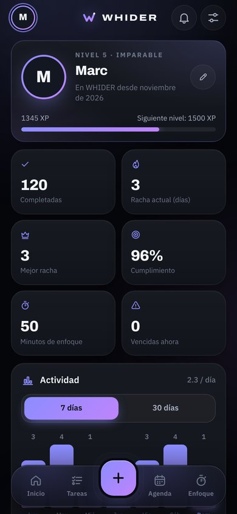
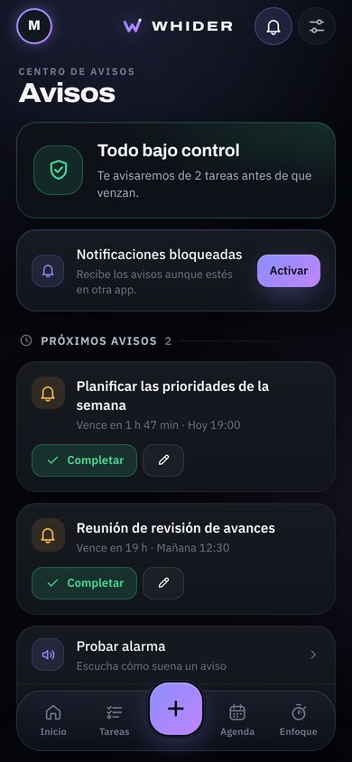
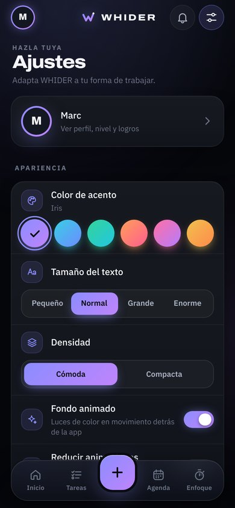

# WHIDER 3.0

**Tu día, bajo control.** WHIDER es una app de productividad para Android (y cualquier navegador) que reúne tareas, agenda, avisos por incumplimiento, modo enfoque y seguimiento de progreso, con un diseño oscuro y efectos fluidos. Funciona 100 % sin conexión y guarda los datos solo en el dispositivo.

<p align="center">
  
  
  
  
</p>
<p align="center">
  
  
  
  
</p>

---

## ✨ Funciones

**Tareas**
- Prioridades (Normal, Destacada, Importante, Urgente) con color propio.
- **Listas** personalizables con color (Personal, Trabajo, Salud… o las que quieras).
- **Subtareas** con barra de progreso, **notas** y **repeticiones** (cada día, días laborables, cada semana, cada mes).
- **Gestos**: desliza → para completar y ← para eliminar, con botón **Deshacer**.
- Búsqueda en títulos, notas y subtareas; filtros (Hoy, Próximas, Vencidas, Sin fecha, Hechas) y 4 tipos de orden.
- Grupos inteligentes y plegables: Vencidas, Hoy, Mañana, Próximos 7 días, Más adelante, Sin fecha y Completadas.

**Avisos**
- **Recordatorio previo** configurable (de 5 minutos a 1 día antes) y **alerta si no la haces** al vencer el plazo, repetible cada 10, 20 o 60 minutos.
- **Horas de silencio**: sin sonidos ni notificaciones en tu horario de descanso (los avisos se retrasan hasta que termina).
- En la app Android, los recordatorios **suenan aunque la app esté cerrada** y se restauran al reiniciar el móvil.
- Centro de avisos con acciones rápidas: Completar, +1 h, Mañana.

**Agenda**
- Calendario mensual con mapa de carga, marcas por prioridad y gesto de deslizar para cambiar de mes.
- Agenda del día con línea de tiempo y botón para añadir una tarea a ese día.

**Enfoque (Pomodoro)**
- Anillo animado, rondas, pausas cortas y largas automáticas y tarea vinculada.
- Exacto aunque la app pase a segundo plano. Notificación y sonido al terminar.

**Progreso**
- Niveles y experiencia, racha actual y mejor racha, % de cumplimiento y minutos de enfoque.
- Gráfica de 7/30 días, **mapa de constancia** de 15 semanas, reparto por listas y **11 logros** desbloqueables.
- Confeti al completar todas las tareas del día.

**Personalización**
- 6 colores de acento (Iris, Océano, Jade, Brasa, Orquídea, Oro): toda la app cambia al instante.
- Tamaño de texto (4 niveles), densidad cómoda o compacta, fondo animado y modo de animaciones reducidas.
- Pantalla al abrir, secciones visibles de Inicio y objetivo diario.
- Lista por defecto, aviso por defecto, primer día de la semana, formato 12/24 h, ocultar completadas y confirmación al eliminar.
- Duración de las sesiones de enfoque y de las pausas.
- Presentación inicial para elegir nombre y color.

---

## 📱 Pantalla y Android

- La interfaz ocupa exactamente la pantalla del dispositivo (barra superior, contenido con scroll y barra inferior flotante) y respeta las zonas seguras (muesca y barra de gestos).
- Se adapta a móviles pequeños (360 px), grandes, en horizontal y a tablets.
- En el APK, el tamaño de fuente del sistema no descuadra el diseño: el tamaño del texto se controla desde **Ajustes → Apariencia**.
- Teclado: los formularios se redimensionan para no quedar tapados.
- Icono adaptable (Android 8+), icono temático (Android 13+) e icono propio en la barra de notificaciones.
- Botón **Atrás**: cierra hojas y menús, vuelve a la pantalla inicial y solo entonces sale.

---

## ▶️ Probar en el ordenador

Con Python 3.8 o superior:

```bash
python serve.py
```

Se abre `http://localhost:8080` y la consola muestra también la dirección para el móvil en tu red Wi‑Fi. Opciones: `python serve.py 9000` (otro puerto) y `python serve.py --no-open`.

Si tienes [`cloudflared`](https://developers.cloudflare.com/cloudflare-one/connections/connect-networks/downloads/) instalado, el servidor crea además un enlace HTTPS temporal: ábrelo en Chrome del móvil y usa **⋮ → Instalar aplicación** para instalarla como app.

## 🛠️ Compilar el APK (Android Studio)

1. Sincroniza la web con el proyecto Android:
   ```bash
   python package_apk.py --sync
   ```
2. Abre la carpeta **`android/`** en Android Studio (JDK 17 o superior) y pulsa **Run**, o desde la terminal:
   ```bash
   cd android
   ./gradlew assembleDebug
   ```
3. El APK queda en `android/app/build/outputs/apk/debug/app-debug.apk`.

---

## 📂 Estructura

```text
.
├── index.html              # Estructura de la app + juego de iconos SVG propio
├── manifest.json           # PWA: iconos y accesos directos (#tasks, #calendar, #focus, #alerts)
├── sw.js                   # Funcionamiento sin conexión y clic en notificaciones
├── css/
│   ├── tokens.css          # Colores, tipografía, tamaños y movimiento
│   ├── layout.css          # Estructura a pantalla completa, fondo animado y barra inferior
│   ├── components.css      # Botones, tarjetas, hojas, interruptores, avisos…
│   └── screens.css         # Estilos de cada pantalla
├── js/
│   ├── core/               # util, store (datos y métricas), audio, notify (motor de avisos)
│   ├── ui/                 # efectos, avisos flotantes, hojas, controles, editor y tarjeta de tarea
│   ├── screens/            # home, tasks, calendar, focus, progress, alerts, settings, onboarding
│   ├── router.js
│   └── app.js
├── icons/                  # Logotipo (SVG) e iconos PNG 192/512/maskable
├── fonts/                  # Archivo e IBM Plex Sans (locales)
├── android/                # Proyecto nativo (WebView + recordatorios + notificaciones)
├── serve.py                # Servidor local para PC y móvil
└── package_apk.py          # Copia la web a android/…/assets/www y crea el ZIP del proyecto
```

## 🔒 Privacidad

Todo se guarda en el propio dispositivo (`localStorage`). La app no tiene cuentas, no envía datos a ningún servidor y no necesita conexión a internet. Las tareas creadas con versiones anteriores se conservan al actualizar.

---

## 📝 Novedades de la 3.0

- Rediseño completo: tema oscuro único y coherente, acentos configurables, fondo animado, transiciones entre pantallas, efectos al pulsar, animación al completar y confeti.
- Iconos propios en SVG y nuevo logotipo (una W cuyo último trazo sube como un ✓).
- Nuevas pantallas: Enfoque, Progreso (con logros y mapa de constancia) y presentación inicial.
- Nuevas funciones: listas, subtareas, notas, repeticiones, recordatorios previos, horas de silencio, búsqueda, orden, gestos con deshacer y decenas de ajustes.
- Android: recordatorios con la app cerrada, vibración nativa, tamaño de texto estable e iconos adaptables.
- Eliminado: copia de seguridad/exportación, descargas e instalación de APK desde la app y la marca "PRO".
