# WHIDER 7.0.2

**Tu día, bajo control.** WHIDER es una app de productividad **para ordenador (Windows, macOS y Linux) y Android** que reúne tareas por categorías, calendario profesional, un **Cuaderno** al estilo de Notion (páginas por bloques, bases de datos y plantillas), hábitos, avisos, enfoque, estadísticas e informes. **Tu personaje** es tu foto de perfil y te acompaña, con **logros y niveles**, y para trabajar con otros tienes **Personas, equipos y chats**: a amigos y compañeros se les añade con un **enlace o un código QR**. Su diseño es **en blanco y negro** (fondo negro, niveles de gris y un brillo blanco contenido en lo activo) con la tipografía **Hanken Grotesk**, una grotesca limpia de la familia de Arial y Helvetica. Incluye **cuentas** (correo o Google) con **copia en la nube**, así que tienes lo mismo en el ordenador y en el móvil, y funciona sin conexión.

<p align="center">
  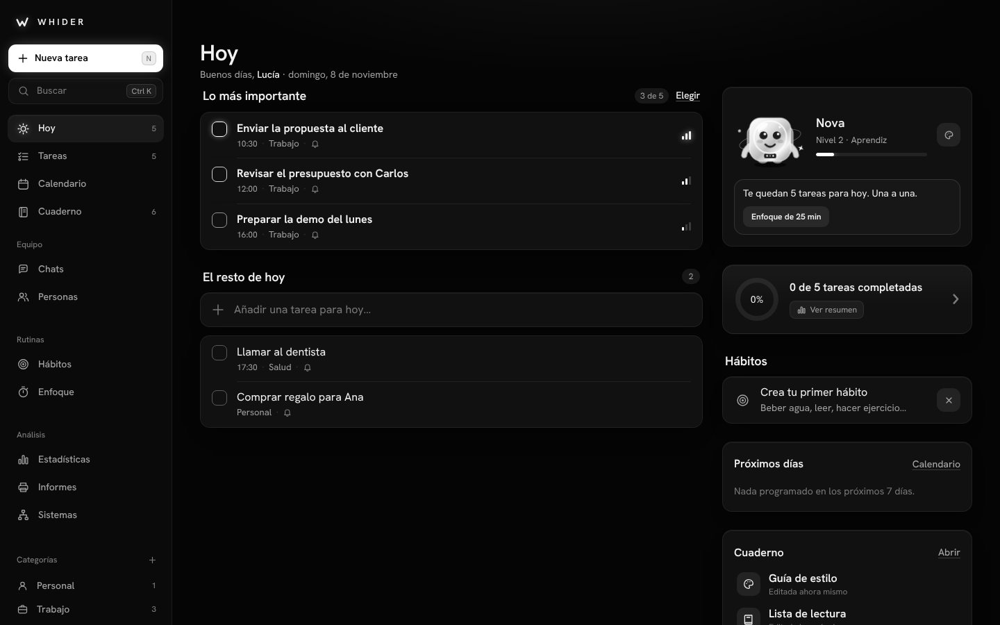
</p>

---

## 🧩 Estructura de WHIDER

La app se divide en tres grandes apartados:

| Apartado | Objetivo |
| --- | --- |
| **PC** | Experiencia avanzada, organización y productividad profesional. |
| **Móvil** | Experiencia rápida, accesible y conectada con el ordenador. |
| **General** | Personalización, tu personaje como foto de perfil, juego (logros y niveles), personas y chats, sonidos, notificaciones y planes. |

### Gratis y Premium

| | Gratis | Premium |
| --- | --- | --- |
| **PC** | Calendario profesional (mes, semana y **día**; duración de las tareas, arrastrar y estirar, exportar a `.ics`) · Tareas por **categorías** con icono · Más orden y organización (**hábitos**, **selección múltiple**, hasta 3 **filtros**, estadísticas de 30 días, informe semanal) · **Cuaderno** completo (páginas, bases de datos y plantillas) | **Sistemas profesionales** (GTD, Eisenhower, bloques de tiempo, 1-3-5, revisión semanal, bandeja a cero, Pomodoro) y **automatizaciones** a medida · Organización muy avanzada (**tablero**, filtros sin límite, **estadísticas de hasta un año**, **informes completos** en PDF, CSV y JSON) · **Personalización avanzada** · **Crear equipos** con su chat y páginas compartidas |
| **Móvil** | Calendario · Tareas por categorías · Cuaderno · **Mejor ecosistema**: una sola app sincronizada con el ordenador | **Mayor rapidez** (plantillas de un toque y sincronización al instante) · **Gestionar el ordenador** (dispositivos y enfoque a distancia) · **Invitar con tu código QR** |
| **General** | Sonidos de botones y avisos · Personaje personalizable y **como foto de perfil** · Logros y niveles · Notificaciones · **Contactos y chats**: aceptar invitaciones, chatear y unirse a equipos | **Invitar** por enlace, QR o código · **Personajes Premium** (astronauta, dragón, fénix, unicornio y gema) con acabados, efectos, fondos y marcos · Copia en la nube al instante |

**Precios:** Gratis para siempre · **Premium 3,99 € al mes o 29,99 € al año** (2,50 € al mes, un 37 % menos), con **14 días de prueba gratis**. Se cambian en [`js/config.js`](js/config.js).

> Para conectar basta con que **una de las dos personas** tenga Premium: quien invita comparte su enlace o su QR, y quien lo recibe se une gratis, chatea y entra en los equipos.

<p align="center">
  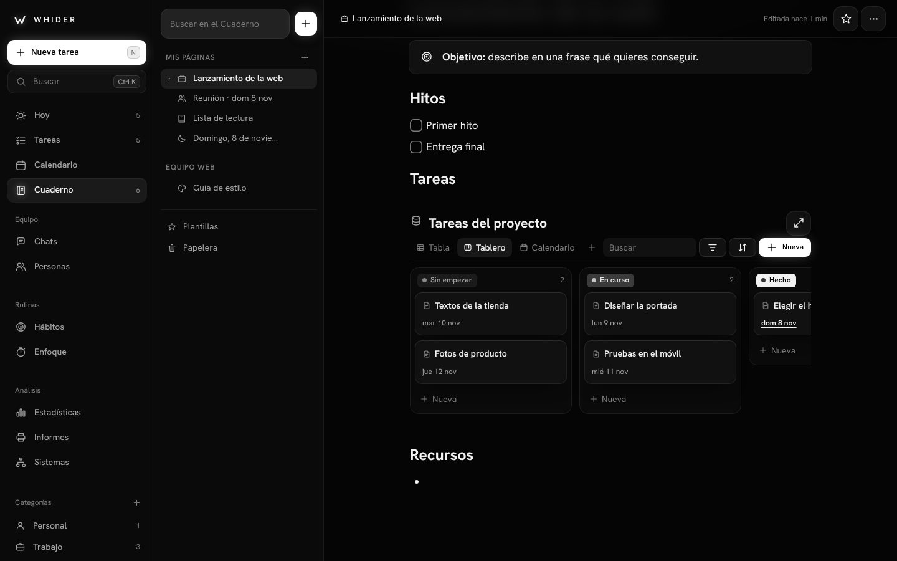
  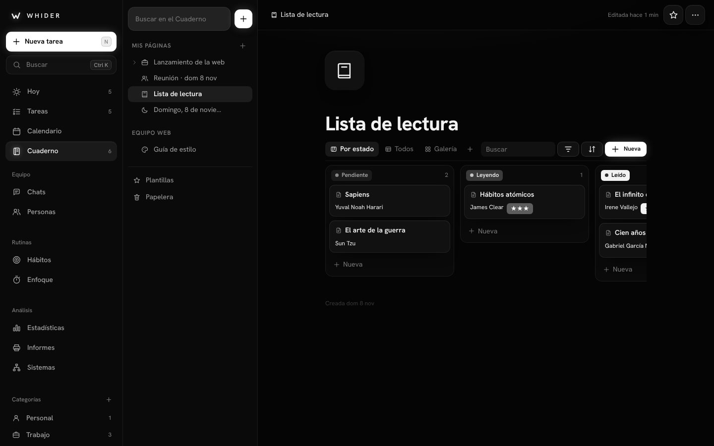
</p>
<p align="center">
  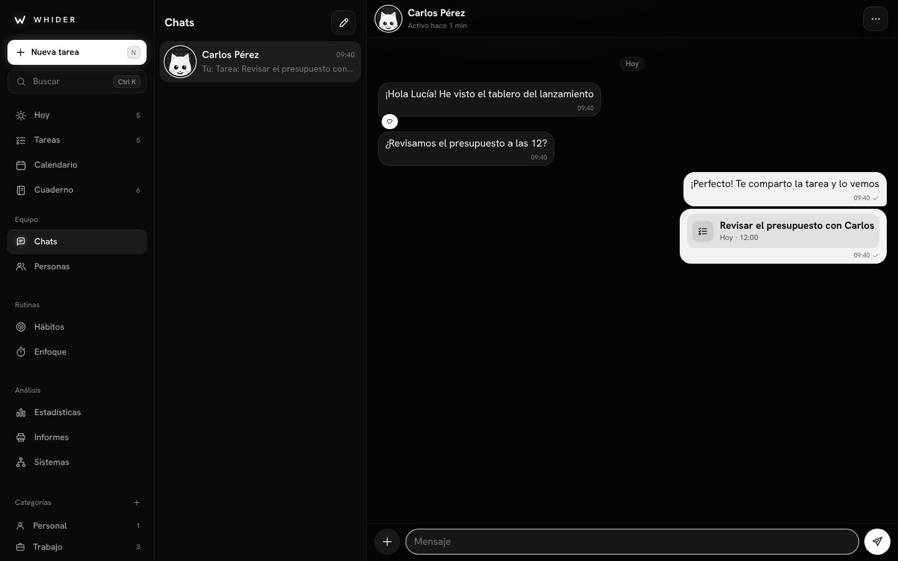
  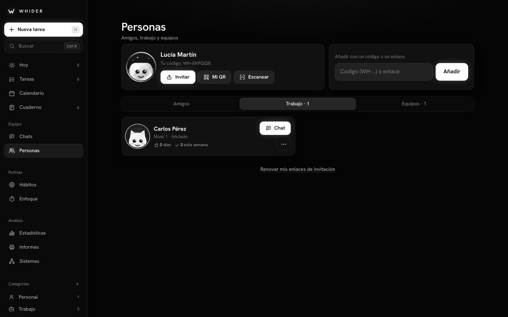
</p>
<p align="center">
  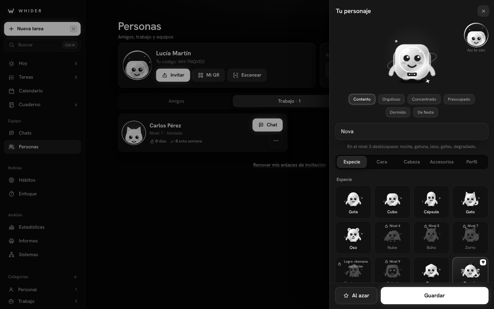
  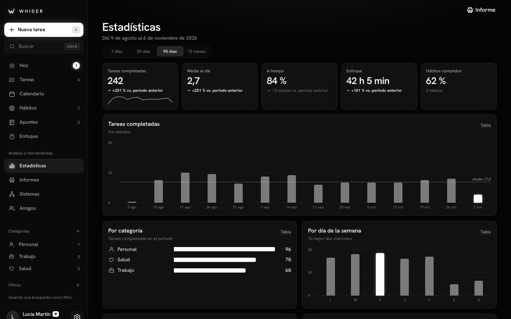
</p>
<p align="center">
  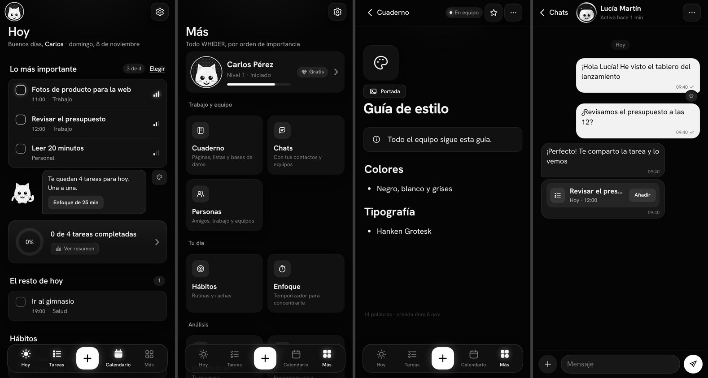
</p>

---

## 💻 WHIDER para ordenador

| Sistema | Descarga | Instalación |
| --- | --- | --- |
| **Windows 10 y 11** | [WHIDER-Setup.exe](https://github.com/McTn4/whider-2.0-PREMIUM/releases/download/desktop-latest/WHIDER-Setup.exe) | Ábrelo y se instala solo (crea un acceso directo). Si aparece «Windows protegió su PC»: **Más información → Ejecutar de todas formas** (la app no está firmada con un certificado de pago). |
| **macOS** | [WHIDER-mac.dmg](https://github.com/McTn4/whider-2.0-PREMIUM/releases/download/desktop-latest/WHIDER-mac.dmg) | Arrastra WHIDER a Aplicaciones. La primera vez, ábrela con **clic derecho → Abrir**. |
| **Linux** | [WHIDER-linux.AppImage](https://github.com/McTn4/whider-2.0-PREMIUM/releases/download/desktop-latest/WHIDER-linux.AppImage) | Dale permiso de ejecución y ábrelo. |

Los instaladores se compilan solos en GitHub con cada cambio (pestaña **Releases → WHIDER para ordenador**). La app también funciona en el navegador del ordenador con el mismo diseño.

**Pensada para pantalla grande, ratón y teclado**
- **Barra lateral ordenada por importancia**: *Nueva tarea* y *Buscar*; **Hoy, Tareas, Calendario y Cuaderno**; **Equipo** (Chats y Personas, con los mensajes sin leer); **Rutinas** (Hábitos y Enfoque); **Análisis** (Estadísticas, Informes y Sistemas); tus **categorías** y **filtros**; y abajo, tu perfil, tu plan y los ajustes. Qué se ve, los contadores y el tamaño se eligen en *Personalización*.
- **Hoy a dos columnas**: arriba, **lo más importante** (hasta 3 tareas: las que elijas o, si no, las más prioritarias, empezando por las vencidas) y después el resto; a la derecha, **quién te está esperando** (mensajes y solicitudes), **tu personaje**, el resumen del día, los hábitos, **los próximos 7 días**, tus páginas recientes y el enfoque (bloques y orden a tu gusto).
- **Varias tareas a la vez**: `Ctrl`/`⌘` clic, `Mayús` clic o `Ctrl A` y una barra para cambiar fecha, hora, prioridad, categoría, repetición y avisos, duplicar, completar o eliminar (con Deshacer). Arrastra cualquiera de ellas y se mueven todas.
- **Cuaderno** con el árbol de páginas a la izquierda y la página a lo ancho; **chats** con la lista y la conversación a la vez; **hábitos en cuadrícula** de 7, 14 o 30 días, **estadísticas** con gráficos y conclusiones e **informes** listos para imprimir o guardar en PDF.
- **Calendario grande**: el **mes** con las tareas dentro de cada día y el día elegido al lado, y la **semana en 7 columnas por horas** con la hora actual. Haz clic en un hueco para crear una tarea a esa hora y **arrastra** cualquier tarea a otro día u otra hora.
- **Editor en un panel a la derecha**, sin perder de vista la lista; diálogos centrados y la creación rápida arriba, como una barra de comandos.
- **Campo para añadir** en Hoy y en cada lista: escribe y pulsa Intro (entiende fecha, hora, `#lista` y `!` de prioridad).
- **Clic derecho** en una tarea: completar, editar, pasarla a hoy, a mañana o al lunes, cambiar la prioridad o la lista, enfocarte en ella o eliminarla.
- **Arrastra** una tarea a una lista de la barra lateral para moverla, a «Hoy» para hacerla hoy o a un día del calendario.
- **Buscar** (`Ctrl K` / `⌘ K`): encuentra tareas y listas, ve a cualquier sección o crea la tarea con lo que has escrito.

**Atajos de teclado** (pulsa `?` para verlos en la app)

| Atajo | Acción |
| --- | --- |
| `N` · `Alt N` | Nueva tarea · nueva página del Cuaderno |
| `Ctrl K` · `/` | Buscar tareas, páginas, personas y acciones |
| `1` … `9` | Hoy · Tareas · Calendario · Cuaderno · Chats · Personas · Hábitos · Enfoque · Estadísticas |
| `/` en una página | Menú de bloques del Cuaderno (títulos, listas, casillas, tablas, bases de datos…) |
| `P` · `Ctrl ,` | Perfil · Ajustes |
| `↑` `↓` · `Espacio` · `Intro` · `Supr` | Moverse por la lista · completar · editar · eliminar |
| `←` `→` · `T` · `M` `S` `D` `A` | En el calendario: anterior y siguiente · hoy · mes, semana, día y agenda |
| `Ctrl` clic · `Mayús` clic · `Ctrl A` | Seleccionar varias tareas · un tramo · todas (`Espacio` las completa, `Supr` las elimina) |
| `Ctrl P` | Informe en PDF (app de escritorio) |
| `Ctrl Intro` · `Esc` | Guardar · cerrar |

**La app de escritorio**
- Ventana con la franja de título integrada en el diseño (Windows y macOS); recuerda su tamaño y posición.
- **Sigue en la bandeja del sistema** al cerrar la ventana para avisarte de tus tareas, y puede **abrirse al iniciar el ordenador** (Ajustes → Ordenador). Desde la bandeja: abrir, nueva tarea, buscar, enfoque y salir.
- Notificaciones del sistema y aviso en el icono de la barra de tareas cuando hay tareas vencidas.
- **Entrar con Google**: se abre tu navegador, eliges la cuenta y vuelves a la app (Google no permite iniciar sesión dentro de otras apps). Con correo y contraseña se entra directamente.
- Funciona sin conexión: la app web va dentro y tus datos se guardan en el ordenador (y en tu cuenta, si has iniciado sesión).

<p align="center">
  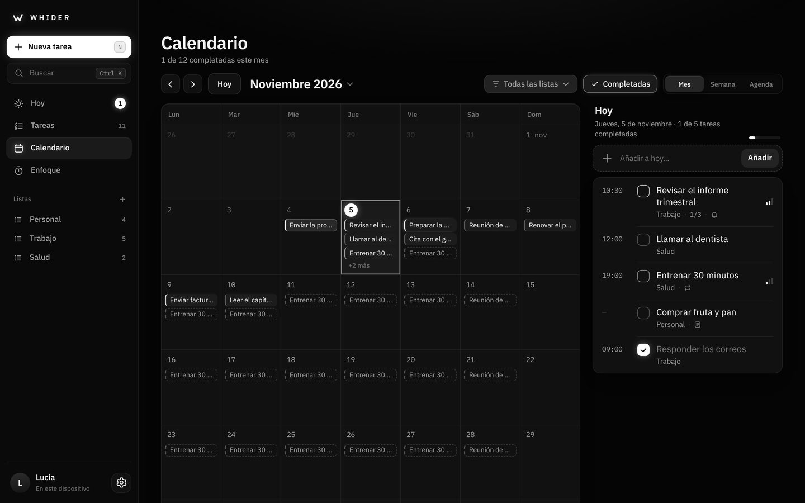
  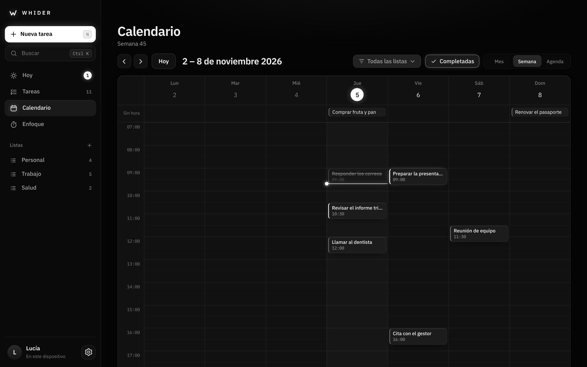
</p>
<p align="center">
  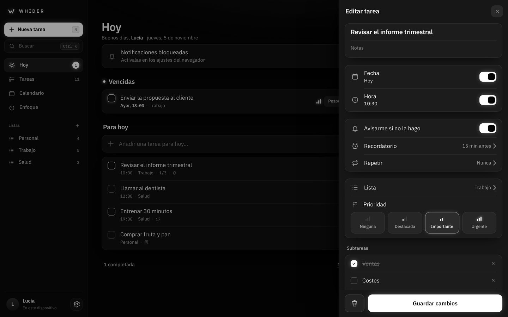
  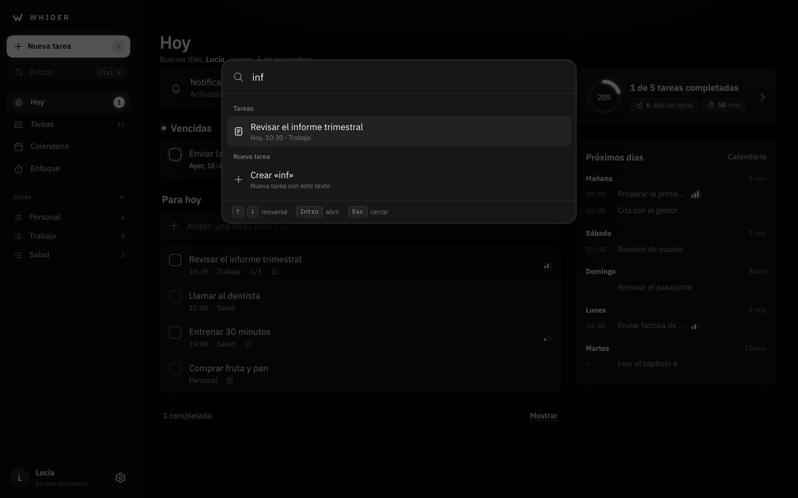
</p>

---

## 🧭 Organización

En el ordenador, las secciones están en la barra lateral, de lo más importante a lo menos. En el móvil, un dock flotante abajo con cuatro pestañas y el botón **+** en el centro:

| Pestaña | Qué encontrarás |
| --- | --- |
| **Hoy** | Arriba, **lo más importante** del día (hasta 3 tareas, elegidas por ti o automáticas); después tu personaje, el progreso, **quién te está esperando** (mensajes y solicitudes), lo **vencido** (con *Posponer*), el resto de hoy, los hábitos y tus páginas recientes. |
| **Tareas** | Buscador, **listas inteligentes** (Hoy · Programadas · Todas · Prioritarias) y **Mis listas** (Personal, Trabajo…). Cada lista abre su propia página. |
| **+** | **Creación rápida** desde cualquier pantalla: escribe «Llamar a Ana mañana a las 10 #trabajo !!» y WHIDER pone la fecha, la hora, la lista y la prioridad. |
| **Calendario** | Vistas de **Mes**, **Semana por horas** y **Agenda**, con filtro por lista y tus tareas que se repiten. |
| **Más** | Todo lo demás, por orden de importancia: **Trabajo y equipo** (Cuaderno, Chats y Personas), **Tu día** (Hábitos y Enfoque), **Análisis** (Estadísticas, Informes y Sistemas) y tu cuenta. La pestaña avisa de los mensajes sin leer. |

Arriba, en todas las pantallas: **tu personaje** (o tu foto, a la izquierda) abre tu **Perfil y resumen** (actividad, marcas y logros) y el **engranaje** (derecha) abre los **Ajustes**, con una página por apartado.

---

## ✨ Funciones

**Cuaderno (antes «Apuntes»)**
- **Páginas por bloques**, como en Notion: texto, tres tamaños de título, listas, casillas, desplegables, citas, avisos destacados, código, separadores, tablas, imágenes, enlaces web, subpáginas, índice, **bases de datos**, **tareas de WHIDER** con su aviso y la **agenda de hoy**. Escribe `/` para el menú de bloques (o `#`, `-`, `[]`… al empezar la línea), arrastra cualquier bloque para moverlo y selecciona texto para darle formato.
- **Páginas dentro de páginas**, con icono, portada, favoritas, papelera y búsqueda en todo el Cuaderno.
- **Bases de datos** con propiedades (texto, número, selección, varias opciones, estado, fecha, casilla, enlace, persona, creada y editada) y vistas de **tabla**, **tablero**, **lista**, **calendario** y **galería**, con filtros, orden y búsqueda. Cada fila es también una página.
- **Plantillas**: reunión, proyecto, diario, apuntes de clase, plan semanal, lista de lectura, hoja de ruta, wiki del equipo y contactos y clientes.
- **Páginas de equipo**: compártelas con un equipo y editadlas a la vez (los cambios se juntan bloque a bloque).
- Se guarda al momento, funciona sin conexión y se sincroniza con tu cuenta. Los apuntes de versiones anteriores se convierten solos en páginas.

**Personas, equipos y chats**
- **Contactos de amigos y de trabajo**, separados. Se añaden con tu **enlace de invitación**, tu **código QR** (se escanea con la cámara del móvil o del ordenador) o tu código `WH-…`. El enlace funciona aunque la otra persona aún no tenga la app: la página de invitación la abre o le dice dónde descargarla.
- **Equipos** con sus miembros, su enlace para entrar, su **chat** y sus **páginas del Cuaderno**.
- **Chats** con cada contacto y con cada equipo: responder, reaccionar, editar y borrar tus mensajes, y compartir **tareas**, **páginas** y ánimos (quien los recibe los añade a lo suyo con un toque). Avisos de mensajes nuevos con la app abierta y contadores en la barra lateral, en *Más* y en Hoy.

**Tu personaje y tu foto de perfil**
- Tu personaje es **tu foto de perfil** en toda la app: la barra lateral, tu perfil, tus contactos, los chats y los equipos. Si lo prefieres, usa tu foto o solo la inicial.
- 15 cuerpos, 10 tonos y ojos, bocas, cabezas, accesorios, efectos, fondos y marcos; muchos se desbloquean subiendo de nivel o con logros. **Premium**: astronauta, dragón, fénix, unicornio y gema; acabados platino, obsidiana, holográfico, cristal, mármol y cromo; halo, capa, gafas de sol y collar de perlas; efectos de aura, órbita, polvo de estrellas y rayos de luz; fondos de estrellas y holográfico, y marcos de diamante, aro de luz y corona.

**Cuentas y copia en la nube**
- Registro con **correo y contraseña** (con verificación del correo, medidor de seguridad de la contraseña y recuperación por correo) o con **Google** (en Android, con el selector nativo de cuentas del teléfono).
- Opción para admitir **solo correos de empresa** (`allowedEmailDomains`).
- Tus tareas, listas, marcas, enfoque y ajustes se guardan en tu cuenta y se **sincronizan automáticamente** entre dispositivos (al abrir la app, al volver a ella, cada minuto y tras cada cambio); los cambios de varios móviles se fusionan sin perder nada.
- Funciona sin internet y sincroniza al volver la conexión. Cerrar sesión y **eliminar la cuenta** desde Ajustes → Cuenta.
- Modo **sin cuenta** opcional: los datos se quedan en el dispositivo y se suben a la cuenta si la creas más tarde.
- Configuración: [docs/CONFIGURAR-CUENTAS.md](docs/CONFIGURAR-CUENTAS.md).

**Tareas y listas**
- **Creación rápida en lenguaje natural**: «mañana», «el lunes», «el 15», «20/11», «en 3 días», «a las 5 de la tarde», «cada semana», «#lista» y «!»/«!!»/«!!!» para la prioridad. Lo detectado aparece en etiquetas que puedes descartar; con Intro se añade y queda listo para la siguiente.
- La prioridad se ve con **luz**: a la derecha de cada tarea se encienden una, dos o tres barras (destacada, importante y urgente) y el borde de la casilla brilla más cuanto más importante es.
- **Listas** propias, más cuatro **listas automáticas** que se rellenan solas (Hoy, Programadas, Todas y Prioritarias).
- Fecha con **calendario integrado**, hora, **subtareas**, **notas** y **repeticiones** (cada día, días laborables, cada semana, cada mes).
- **Gestos**: desliza → para completar y ← para eliminar, con **Deshacer**.
- Búsqueda en títulos, notas y subtareas; orden por fecha, prioridad, recientes o título.
- Si cierras el editor con cambios sin guardar, WHIDER te pregunta antes de descartarlos.

**Avisos**
- **Recordatorio previo** configurable (de 5 minutos a 1 día antes) y **aviso si no la haces** al vencer el plazo, repetible cada 10, 20 o 60 minutos.
- **Horas de silencio**: sin sonidos ni notificaciones en tu horario de descanso.
- En la app Android, los recordatorios **suenan aunque la app esté cerrada** y se restauran al reiniciar el móvil.

**Calendario**
- **Mes**: un punto por tarea pendiente (hasta tres), uno que brilla si hay algo vencido y uno hueco para las repeticiones futuras; menú para saltar de mes y el día elegido con sus tareas por hora y un campo para **añadir directamente a ese día**.
- **Semana**: tira de 7 días con su progreso y el **día por horas** con la hora actual; **toca un hueco** para crear una tarea a esa hora y **mantén pulsada una tarea para arrastrarla** a otra hora.
- **Agenda**: lo vencido y los próximos 30 días, día a día.
- Las tareas que se repiten se ven también en los días futuros, filtro por lista y opción de ocultar las completadas.

**Enfoque**
- Sesiones y pausas cortas o largas, con pausas automáticas opcionales y una tarea vinculada.
- Exacto aunque la app pase a segundo plano. Notificación y sonido suave al terminar.

**Perfil, marcas y logros**
- Tu foto, nombre y **nivel**; completadas, racha y minutos de enfoque; gráfica de 7 o 30 días, **mapa de constancia** de 15 semanas y reparto por listas.
- **Récords automáticos** (mejor racha, más tareas en un día, mejor semana, más enfoque en un día) e **hitos**.
- **Marcas personales**: tiempos, pesos, distancias, páginas… con su evolución. El historial es permanente: **no se borra aunque elimines tareas**.
- **11 logros** desbloqueables.

**Tus datos no se pierden**
- Todo se guarda al instante en el dispositivo; en el APK además en un almacén nativo de Android, que los recupera aunque el sistema limpie el almacenamiento de la app.
- Con cuenta, también en la nube: al iniciar sesión en otro móvil lo recuperas todo.

**Personalización (Ajustes)**
- Tamaño de texto (4 niveles), densidad cómoda o compacta y movimiento reducido.
- Pantalla al abrir, lista por defecto, aviso por defecto, primer día de la semana, formato 12/24 h y confirmación al eliminar.
- Duración de las sesiones de enfoque y de las pausas.

---

## 📱 Pantalla y Android

> **Descarga el APK**: [app-debug.apk](https://github.com/McTn4/whider-2.0-PREMIUM/releases/download/apk-latest/app-debug.apk) (pestaña **Releases → WHIDER (última versión)**). Se recompila solo cuando cambia el proyecto Android (como en la 7.0); para compilarlo a mano con la app web más reciente: **Actions → Compilar APK → Run workflow**.

- Los **enlaces de invitación** (`https://whider-red.vercel.app/i/…`) abren la app directamente, y el lector de **códigos QR** usa la cámara trasera.

- La interfaz ocupa exactamente la pantalla del dispositivo (barra superior, contenido con scroll y dock flotante) y respeta las zonas seguras (muesca y barra de gestos). Las barras del sistema de Android usan los mismos tonos que la app.
- Se adapta a móviles pequeños (360 px), grandes, en horizontal y a tablets.
- En el APK, el tamaño de fuente del sistema no descuadra el diseño: el tamaño del texto se controla desde **Ajustes → Apariencia**.
- Teclado: los formularios se redimensionan para no quedar tapados.
- Icono adaptable (Android 8+) con la W en blanco sobre negro, icono temático (Android 13+) e icono propio en la barra de notificaciones.
- Botón **Atrás**: cierra menús y hojas, vuelve a la página anterior (de una lista a Tareas, del Perfil a la pestaña en la que estabas o dentro de Ajustes), después a la pestaña inicial y solo entonces sale.

---

## ▶️ Probar en el navegador

Con Python 3.8 o superior:

```bash
python serve.py
```

Se abre `http://localhost:8080` y la consola muestra también la dirección para el móvil en tu red Wi‑Fi. Opciones: `python serve.py 9000` (otro puerto) y `python serve.py --no-open`.

Si tienes [`cloudflared`](https://developers.cloudflare.com/cloudflare-one/connections/connect-networks/downloads/) instalado, el servidor crea además un enlace HTTPS temporal: ábrelo en Chrome del móvil y usa **⋮ → Instalar aplicación** para instalarla como app.

## 🛠️ Abrir y compilar la app de escritorio

Con Node.js 20 o superior:

```bash
cd desktop
npm install
npm start
```

`npm start` copia la app web a `desktop/www` y abre WHIDER. Para crear el instalador de tu sistema: `npm run dist` (queda en `desktop/dist`).

## 🛠️ Compilar el APK (Android Studio)

1. Sincroniza la web con el proyecto Android:
   ```bash
   python package_apk.py --sync
   ```
2. Abre la carpeta **`android/`** en Android Studio (JDK 17 o superior) y pulsa **Run**, o desde la terminal:
   ```bash
   cd android
   ./gradlew assembleDebug
   ```
3. El APK queda en `android/app/build/outputs/apk/debug/app-debug.apk`.

---

## 📂 Estructura

```text
.
├── index.html              # Estructura de la app + juego de iconos SVG propio
├── manifest.json           # PWA: iconos y accesos directos (nueva tarea, nueva página, chats, hábitos)
├── sw.js                   # Funcionamiento sin conexión y clic en notificaciones
├── i/index.html            # Página de las invitaciones (enlaces y QR): abre la app o enseña a descargarla
├── .well-known/            # assetlinks.json: los enlaces de invitación abren la app de Android (App Links)
├── css/
│   ├── tokens.css          # Grises, sombras, brillos, tipografía, tamaños y movimiento
│   ├── layout.css          # Pantalla de carga, estructura a pantalla completa, barra superior y dock
│   ├── components.css      # Celdas agrupadas, botones, hojas, alertas, menús, interruptores…
│   ├── screens.css         # Estilos de cada pantalla
│   ├── social.css          # Personas, chats, avatares con tu personaje, invitaciones y QR, Más
│   ├── cuaderno.css        # Cuaderno: editor por bloques y bases de datos (se carga al abrirlo)
│   └── desktop.css         # Ordenador: barra lateral, diálogos, calendario grande, ratón y teclado
├── firestore.rules         # Reglas de seguridad: tus datos solo tuyos; perfiles, buzón, equipos y chats solo de sus miembros
├── firebase.json           # Configuración de Firebase (reglas, hosting y emuladores)
├── js/
│   ├── config.js           # ← Configuración de cuentas (Firebase), planes y enlaces: ver docs/CONFIGURAR-CUENTAS.md
│   ├── vendor/             # SDK de Firebase empaquetado (funciona sin CDN), generador y lector de códigos QR
│   ├── core/               # util, store, parse (lenguaje natural), audio (sonidos), notify, records, auth (cuentas),
│   │                       #   sync (nube), habits, plan (Gratis/Premium), game (logros y niveles),
│   │                       #   automations (motor de reglas), stats (estadísticas), pages y pagesync (Cuaderno),
│   │                       #   community (personas y equipos), chat (chats) e invite (enlaces y QR)
│   ├── ui/                 # anillos, avisos, menús, hojas, controles, perfil, editor, creación rápida, fila de tarea,
│   │                       #   diseño (layout), barra lateral, búsqueda, atajos, selección múltiple (select),
│   │                       #   filtros, personaje (character), avatares (avatar), gráficos (charts),
│   │                       #   dispositivos/plantillas (devices) y, para el Cuaderno, blocks (editor) y dbview (bases de datos)
│   ├── screens/            # home (Hoy), tasks, calendar, notes (Cuaderno), chats, friends (Personas), more (Más),
│   │                       #   habits, focus, stats, reports, automations (Sistemas), plans (Planes), progress (Perfil), settings…
│   ├── router.js
│   └── app.js
├── icons/                  # Logotipo (SVG) e iconos PNG 192/512/maskable
├── fonts/                  # Hanken Grotesk (variable), local, y su licencia OFL
├── desktop/                # App de escritorio (Electron): ventana, bandeja, acceso con Google por el navegador
├── android/                # Proyecto nativo (WebView + recordatorios + notificaciones)
├── tools/firebase-bundle/  # Cómo regenerar js/vendor/firebase.js
├── serve.py                # Servidor local para PC y móvil
└── package_apk.py          # Copia la web a android/…/assets/www y crea el ZIP del proyecto
```

## 💎 Planes, pagos y comunidad (para quien publica la app)

- **Prueba gratuita**: 14 días, una vez por cuenta, desde *Planes* o desde cualquier función Premium.
- **Códigos de activación**: se canjean en *Planes → Código de activación*. En [`js/config.js`](js/config.js) solo se guarda su huella cifrada (SHA-256), así que el código en claro no aparece en ningún archivo: guárdalo solo para ti, porque el repositorio es público.
- **Cobrar**: pon tu enlace de pago (por ejemplo un *Payment Link* de Stripe) en `premium.checkoutUrl` de [`js/config.js`](js/config.js). Tras el pago, envía al cliente un código de activación. Para activar Premium automáticamente al pagar hace falta un pequeño servidor (por ejemplo una Cloud Function con el *webhook* de Stripe); los pasos están en [`docs/CONFIGURAR-CUENTAS.md`](docs/CONFIGURAR-CUENTAS.md).
- **Personas, chats y equipos (7.0)**: publica las reglas nuevas de [`firestore.rules`](firestore.rules) en *Firebase → Firestore Database → Reglas* y añade `whider-red.vercel.app` en *Authentication → Configuración → Dominios autorizados*. Los enlaces de invitación usan `links.base` de [`js/config.js`](js/config.js). Detalles en [`docs/CONFIGURAR-CUENTAS.md`](docs/CONFIGURAR-CUENTAS.md).

## 🔒 Privacidad

Sin cuenta, todo se queda en el dispositivo. Con cuenta, los datos se guardan además en tu proyecto de Firebase, protegidos por reglas que solo permiten a cada usuario acceder a lo suyo ([`firestore.rules`](firestore.rules)). Tus contactos solo ven tu perfil público (nombre, personaje o foto, nivel, racha y cuántas tareas y minutos de enfoque llevas en la semana), nunca tus tareas ni tu Cuaderno. Los mensajes de un chat solo los leen sus miembros, y las páginas de un equipo, solo los miembros del equipo. WHIDER nunca ve ni guarda contraseñas (las gestiona Firebase Authentication), no muestra publicidad y permite eliminar la cuenta y todos sus datos de la nube (también el Cuaderno, el perfil público y el código de contacto) desde Ajustes.

---

## 📝 Novedades de la 7.0.2

App de escritorio (Windows y macOS):
- El **Cuaderno** y los **Chats** empiezan debajo de la franja de título de la ventana. Antes, el buscador del Cuaderno, el botón *+*, la ruta de la página y los botones de favorita y *⋯* (y la cabecera de los chats) quedaban tapados por la franja y por los botones de minimizar, maximizar y cerrar.
- Los menús y las ventanitas del editor nunca se colocan sobre esa franja.
- Al cambiar de pantalla (también desde la bandeja o un aviso) se cierra el menú que estuviera abierto.

## 📝 Novedades de la 7.0.1

Retoques de diseño en el Cuaderno:
- La **portada** de una página es ahora una tarjeta entera, separada de la barra de arriba (antes quedaba pegada a ella y parecía cortada). Las portadas *Ondas* y *Papel* tienen dibujo propio.
- Los **tableros** muestran enteras tres columnas en el ancho de la página; si hay más, se desplazan.
- En el móvil, las **vistas** de una base de datos (Tabla, Tablero…) ya no se aprietan hasta desaparecer, y el botón *Nueva* no se sale de la pantalla.

## 📝 Novedades de la 7.0

**Cuaderno, el nuevo nombre de Apuntes, al estilo de Notion**
- Editor **por bloques** con menú `/`, atajos de Markdown, arrastrar bloques, formato al seleccionar, **subpáginas**, portadas, iconos, favoritas y papelera.
- **Bases de datos** con 11 tipos de propiedad y 5 vistas (tabla, tablero, lista, calendario y galería), filtros y orden.
- **9 plantillas** y **páginas de equipo** que se editan a la vez. Tus apuntes anteriores pasan solos al Cuaderno, y la copia de seguridad (JSON) también lo incluye.

**Personas: amigos y trabajo, por enlace o código QR**
- Contactos **de amigos y de trabajo**, separados. Invitación por **enlace** (con página propia que abre la app), **código QR** con tu personaje en el centro y **lector de QR** con la cámara; también por código `WH-…`.
- Arreglado: ya no hace falta que las dos personas tengan Premium. Basta con quien invita; quien recibe la invitación se une gratis.
- **Equipos** con enlace para entrar, miembros, chat y páginas compartidas.

**Chats**
- Con cada contacto y con cada equipo: responder, reaccionar, editar, borrar, compartir tareas y páginas, avisos y contadores de mensajes sin leer.

**Personajes como foto de perfil**
- Tu personaje es tu avatar en toda la app (o tu foto, o tu inicial). **5 personajes Premium** nuevos, 6 acabados, efectos, fondos y marcos exclusivos.

**Mejor orden en PC y móvil, por prioridades**
- **Lo más importante** arriba en Hoy (hasta 3 tareas elegidas por ti o automáticas) y **quién te está esperando** justo después.
- Ordenador: barra lateral por grupos (lo diario, Equipo, Rutinas, Análisis) y atajos `1`–`9` en ese orden; `Alt N` crea una página.
- Móvil: dock con **Hoy, Tareas, +, Calendario y Más**; *Más* reúne el resto por orden de importancia y avisa de los mensajes.

**Además**
- Eliminar la cuenta borra también de la nube el Cuaderno, el perfil público, el código de contacto y los equipos en los que se estaba solo.
- Al cambiar de cuenta en un mismo dispositivo, no se ven los chats de la cuenta anterior.
- El editor del Cuaderno se carga al abrirlo por primera vez, para que la app siga arrancando rápido.

## 📝 Novedades de la 6.0.1

- **Códigos de activación privados**: el código de fundador de la 6.0 deja de valer y en el repositorio solo queda la huella cifrada de los códigos.
- **Imprimir** (Ctrl P) funciona en cualquier pantalla; en *Informes* y al guardar en PDF sale solo el informe, en negro sobre blanco.

## 📝 Novedades de la 6.0

**Estructura PC · Móvil · General, con plan Gratis y Premium**
- **Planes y precios** con la comparativa por PC, Móvil y General, prueba de 14 días, códigos de activación y enlace de pago configurable.
- **Tipografía nueva**: Hanken Grotesk en el móvil y en el ordenador.

**PC**
- **Calendario profesional**: vista **Día**, **duración** de las tareas (bloques que se estiran arrastrando), fines de semana y horas a tu gusto y **exportar a otros calendarios** (`.ics`).
- **Categorías con icono** (antes «listas»), **filtros guardados** y **tablero** por categoría, prioridad o fecha.
- **Selección múltiple** con barra de acciones completa e importar/exportar tareas en **CSV** y copias en **JSON**.
- **Apuntes** a dos paneles con formato ligero; las casillas se convierten en tareas.
- **Hábitos**: cuadrícula de días, rachas, mapa de 18 semanas, objetivos diarios y recordatorios.
- **Estadísticas** (cifras con variación, por día, semana y hora, categorías, prioridades, enfoque, hábitos, año entero y conclusiones) e **informes** imprimibles, en PDF, CSV o JSON.
- **Sistemas profesionales** de un toque y **automatizaciones** «Cuando… Si… Entonces…» con prueba e historial.
- **Personalización avanzada**: barra lateral, bloques de Hoy y su orden, calendario y ancho del contenido.
- **Comunidad**: código de amigo, solicitudes, ranking semanal, ánimos y **espacios compartidos**.

**Móvil**
- Hábitos en Hoy, apuntes, selección (mantén pulsada una tarea), estadísticas resumidas y «Tu semana».
- **Premium**: **plantillas de un toque**, sincronización al instante, **gestionar el ordenador** (dispositivos y enfoque a distancia) y amigos.

**General**
- **Tu personaje**: cuerpo, tono, ojos, boca, cabeza y accesorios; estados de ánimo según tu día; te habla al tocarlo y aparece en Hoy, el perfil, el enfoque, las pantallas vacías y las celebraciones.
- **Logros y niveles** renovados: 16 familias con grados, barras de progreso, experiencia de todo lo que haces y **recompensas** para tu personaje al subir de nivel.
- **Sonidos**: botones, avisos y logros por separado, cuatro estilos y volumen. Alto contraste en Apariencia.

## 📝 Novedades de la 5.0

**WHIDER para ordenador**
- App de escritorio para **Windows, macOS y Linux**, con instaladores que se compilan solos en GitHub.
- Diseño propio para pantalla grande: barra lateral con secciones y listas, Hoy a dos columnas con los próximos días, editor en un panel a la derecha y diálogos centrados.
- **Calendario grande**: mes con las tareas dentro de cada día y semana en 7 columnas por horas; clic en un hueco para crear y arrastrar para cambiar de día o de hora.
- **Ratón**: clic derecho en las tareas y arrastrarlas a una lista, a «Hoy» o a un día del calendario.
- **Teclado**: búsqueda y acciones con `Ctrl K`, atajos para todo y ayuda con `?`.
- Bandeja del sistema, abrir al iniciar el ordenador, notificaciones del sistema y aviso de tareas vencidas en el icono.
- Entrar con Google desde el navegador del ordenador y vuelta automática a la app.

**Móvil**
- Sin cambios: se mantiene la 4.4 y su APK.

## 📝 Novedades de la 4.4

**Blanco y negro**
- Toda la interfaz pasa a **blanco y negro**: fondo negro, superficies en grises, sombras profundas bajo cada tarjeta y un **brillo blanco contenido** en lo activo (botón principal, día elegido, pestaña actual, casillas marcadas y la hora actual del calendario).
- Desaparecen los colores de acento y los colores de las listas, junto con sus selectores. No se pierde ningún dato: los colores elegidos en versiones anteriores simplemente dejan de usarse.
- La prioridad se ve con **luz**: tres barras que se encienden (destacada, importante, urgente) y un borde de la casilla más brillante cuanto más importante es la tarea. Lo vencido se señala con un punto que brilla.

**Tipografía nueva**
- **IBM Plex Sans** para el texto e **IBM Plex Mono** para cifras, horas y fechas (contadores, calendario, estadísticas y marcas). Títulos con pesos más moderados.

**Sin aspecto de plantilla**
- Iconos de trazo sin baldosas de colores, diálogos sin adornos y textos más directos, sin primera persona.
- Presentación inicial reducida a la W, el nombre de la app y un paso para tu perfil.
- El botón + se integra en el dock en lugar de flotar sobre él.

**Pantalla de carga más simple**
- Solo la **silueta de la W**: se traza de un solo gesto y se ilumina. Sin gráfica, sin puntos y sin rótulo.

**Icono**
- La W en blanco con un brillo suave sobre negro, en la web, en Android y en el icono adaptable.

**Rendimiento** (móvil de gama media simulado, 120 tareas): primer render 303 ms (antes 329); completar una tarea sigue en 41 ms.

## 📝 Novedades de la 4.3

**Diseño propio, minimalista y con profundidad**
- Se mantiene la estructura limpia de la 4.2, pero con identidad WHIDER en lugar de copiar a Apple: tipografía **Manrope**, fondo de tinta oscura con un leve tono azulado, tarjetas con **sombras suaves**, brillo moderado en los elementos de acento y transiciones cortas.
- Controles propios: interruptores, pestañas segmentadas, diálogos con botones, menús y avisos rediseñados; prioridad en el color del círculo de cada tarea.
- Paleta propia de 12 colores (iris por defecto) e icono de la app con el punto en el color de la marca.

**Pantalla de carga**
- Al abrir la app, la **W del logotipo se dibuja como una gráfica**: líneas de fondo, la línea que pasa por cada punto, el relleno y el último punto que se ilumina con tu color. Dura menos de dos segundos y se puede saltar tocándola.

**Más fácil de usar**
- **Ajustes siempre a mano**: el engranaje está en la barra superior de todas las pantallas (y en el Perfil).
- **Botón + central** en el dock con **creación rápida en lenguaje natural** y «Más detalles» para abrir el editor completo.
- El editor guarda con un botón grande abajo y elige la prioridad con botones visuales.

**Calendario mucho más completo**
- Vistas de **Mes**, **Semana por horas** y **Agenda**; repeticiones previstas, filtro por lista, ocultar completadas, añadir directamente a un día, tocar un hueco para crear a esa hora y **arrastrar una tarea para cambiar su hora**.

**Adiós definitivo a las tareas de ejemplo**
- Se eliminan todas las tareas de ejemplo de cualquier versión anterior aunque estén completadas, repetidas, sin su marca o copiadas en la nube, y el borrado se sube a tu cuenta. Las tareas que escribes tú nunca se tocan.

**Rendimiento** (móvil de gama media simulado, 120 tareas): primer render 329 ms (antes 368) y completar una tarea 41 ms (antes 52).

## 📝 Novedades de la 4.2

**Diseño sobrio, al estilo de Apple**
- Fondo negro, celdas agrupadas con separadores finos, títulos grandes y una barra de pestañas fija. Sin degradados, brillos, confeti ni ondas al pulsar.
- Un único color de acento (azul por defecto) y 12 colores del sistema para elegir; interruptores, controles segmentados, menús y alertas como los del iPhone.
- Tipografía Inter (la más parecida a la del sistema de Apple), 110 KB más ligera que las dos fuentes anteriores.
- Interfaz silenciosa: los toques ya no vibran ni suenan; solo hay una respuesta suave al completar una tarea y en los avisos.
- Icono nuevo de la app en grafito, blanco y azul.

**Todo mejor organizado**
- Cinco pestañas: **Hoy, Tareas, Calendario, Enfoque y Resumen**. Tu foto abre **Ajustes**, con una página por apartado.
- **Tareas** al estilo de Recordatorios: listas inteligentes (Hoy, Programadas, Todas, Prioritarias) y tus listas, cada una con su página, su color y su menú (ordenar, borrar completadas, editar o eliminar la lista).
- Lo vencido vive ahora en **Hoy** (con *Posponer*) y la pestaña muestra cuántas tareas hay vencidas; desaparece la pantalla aparte de avisos.
- Editor de tareas por apartados: fecha con calendario integrado, hora, aviso, recordatorio, repetición, lista, prioridad y subtareas. Pregunta antes de descartar cambios.
- Las opciones cortas se eligen en menús junto al botón, en lugar de abrir hojas una tras otra.

**Sin tareas de ejemplo**
- Se eliminan las tareas de ejemplo que quedaban de versiones anteriores, también sus repeticiones y las copias guardadas en la nube (se respetan las que hubieras cambiado y convertido en tuyas).

**Igual de rápida**
- Medido en un móvil de gama media simulado (120 tareas): primer render 368 ms (antes 385 ms), completar una tarea 52 ms y abrir la lista «Todas» 49 ms (antes 73 ms).

## 📝 Novedades de la 4.1

**Más rápida**
- Firebase se carga en segundo plano después de mostrar la app y pesa 3 veces menos (Firestore "lite": 631 KB → 203 KB).
- Solo se guarda lo que cambia, y en Android la copia nativa se escribe agrupada y sin bloquear (antes, cada toque escribía 8 veces en disco).
- Sin efectos caros: fuera el desenfoque en tiempo real, el grano animado y las sombras grandes. Transiciones más cortas.
- Medido en un móvil de gama media simulado: completar una tarea pasa de 205 ms a 89 ms y abrir Tareas de 191 ms a 83 ms.

**Más tranquila y ordenada**
- Barra superior con solo dos botones (tu foto y los avisos). Ajustes y Marcas viven dentro del Perfil.
- Inicio con lo esencial: tu progreso de hoy y la lista de hoy.
- Tareas en tres pestañas (Hoy · Próximas · Todas), con la búsqueda y las opciones en un único menú.
- Tarjetas de tarea con una línea de texto discreta en lugar de "pastillas"; editor con los detalles en filas.
- Avisos con una sola acción (Posponer); un único aviso flotante aunque venzan varias tareas.
- Ajustes en apartados; la app empieza limpia, sin tareas de ejemplo.

**Perfil con foto**
- Foto de perfil desde la galería (selector de fotos de Android, sin permisos), recortada y comprimida (~25 KB) y sincronizada con tu cuenta. Con Google se usa tu foto de Google si no eliges otra.

**Correcciones**
- Google en Android: los fallos de configuración (huella SHA‑1 o paquete no registrados) ya no se quedan en silencio; la app explica qué revisar y muestra el detalle técnico.
- El nombre ya no se sobrescribe con el de Google al entrar desde otro dispositivo, y la presentación inicial no se repite.
- El historial y las marcas se reparan solos si llegan datos incompletos de versiones anteriores.

## 📝 Novedades de la 4.0

- Cuentas de usuario con correo y contraseña (verificación y recuperación) y con Google.
- Copia en la nube con sincronización automática entre dispositivos y funcionamiento sin conexión.
- Registro de marcas: récords automáticos con historial permanente y marcas personales con su evolución.
- Android: la app se sirve desde un origen seguro local, con espejo nativo de los datos y migración automática desde la versión anterior.

## 📝 Novedades de la 3.0

- Rediseño completo: tema oscuro único y coherente, acentos configurables, fondo animado, transiciones entre pantallas, efectos al pulsar, animación al completar y confeti.
- Iconos propios en SVG y nuevo logotipo (una W cuyo último trazo sube como un ✓).
- Nuevas pantallas: Enfoque, Progreso (con logros y mapa de constancia) y presentación inicial.
- Nuevas funciones: listas, subtareas, notas, repeticiones, recordatorios previos, horas de silencio, búsqueda, orden, gestos con deshacer y decenas de ajustes.
- Android: recordatorios con la app cerrada, vibración nativa, tamaño de texto estable e iconos adaptables.
- Eliminado: copia de seguridad/exportación, descargas e instalación de APK desde la app y la marca "PRO".
